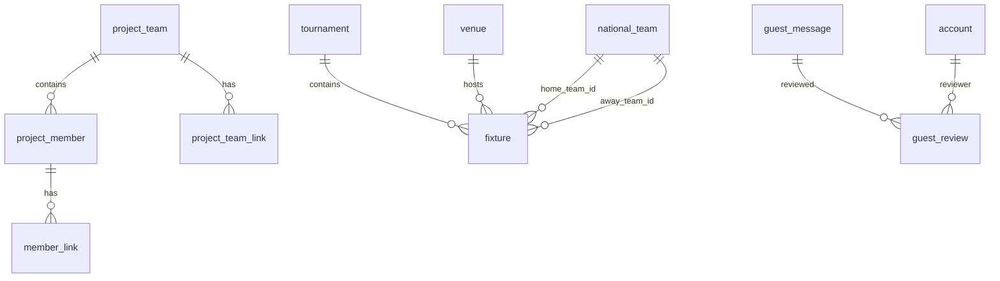

# 世界杯专题站数据与路由契约

版本：v1，2026-11-13。

本文定义数据库结构、路由、管理员共享接口及比赛样本格式。已完成契约设计与静态核对，未包含数据库迁移或页面实现。

## 1. 范围与共同约定

- 世界杯为主站；`/team` 是独立的课设团队栏目。仅做一届精选小组赛，不做实时数据、积分榜、淘汰赛推演或用户注册。
- 默认主题为 2026 男足世界杯。正式样本从 FIFA 官方页面摘录 4–6 场真实小组赛，另备演示记录。本文的三条验收数据都是虚构演示，不是官方赛果。
- PHP / Yii2 Basic / MySQL，本地运行，不使用 Docker、不部署公网。Windows 或 WSL 均可，运行版本、数据库版本、启动命令及端口在环境配置中记录。
- 数据库名由本机配置指定；业务表无前缀，使用 InnoDB、`utf8mb4`、`utf8mb4_unicode_ci`。所有名称和表单长度以字符计；标识代码统一大写 ASCII。
- 表名、字段名为 `snake_case`；PHP 类名为 `PascalCase`、方法为 `camelCase`；自编 PHP 文件必须有包含用途和作者的注释头。
- 仅有下列 11 张业务表。Yii 的 `migration` 是框架记录表，不计入课程要求；下载从固定目录读取，不另建文件表；不引入 RBAC 业务表。
- 课设队名、成员身份和公开资料以团队确认的信息为准。不得从仓库名猜测队名或把演示成员当作真实同学。

## 2. 数据表与迁移依赖

| 表 | 含义 |
| --- | --- |
| `account`  |  后台管理员 |
| `project_team`  |  我们的课设团队 |
| `project_member`  |  课设成员 |
| `member_link`  |  成员的公开链接 |
| `tournament`  |  世界杯届次 |
| `national_team`  |  参赛国家队 |
| `venue`  |  比赛场馆 |
| `fixture`  |  比赛、比分与发布状态 |
| `guest_message`  |  站点级世界杯留言 |
| `project_team_link`  |  团队资源链接 |
| `guest_review`  |  留言审核历史 |

每张表均有 `id INT UNSIGNED AUTO_INCREMENT PRIMARY KEY`、`created_at DATETIME NOT NULL`、`updated_at DATETIME NOT NULL`，时间由应用按 UTC 写入；下方字段表省略这三列。外键列一律与父表 `id` 类型一致。`updated_at` 在每次成功写入时更新，不能使用本机时区的隐式数据库默认值。

迁移文件使用 Yii 的时间戳命名和描述性后缀，避免重复创建同名表。创建顺序：`account`；`project_team → project_member → member_link`；`tournament / national_team / venue → fixture`；`guest_message`；`project_team_link`；`guest_review`。没有外键关系的分支可独立执行。回滚按实际依赖逆序删除，不先删父表。

全部外键 `ON UPDATE RESTRICT`。课设链接、成员的从属外键使用 `ON DELETE CASCADE`；比赛的四个外键和审核的两个外键使用 `ON DELETE RESTRICT`。本期无对外删除入口；不在后台删除已被引用的国家队、场馆、账号或留言。

### 2.1 account

| 字段 | MySQL 类型 | 可空 / 默认 | 约束与含义 |
| --- | --- | --- | --- |
| `username` | `VARCHAR(64)` | 否 / 无 | 唯一；trim 后仅小写 ASCII 字母、数字、下划线，3–64 字符 |
| `password_hash` | `VARCHAR(255)` | 否 / 无 | Yii 安全组件生成的密码哈希，不存明文 |
| `auth_key` | `VARCHAR(64)` | 否 / 无 | Yii 安全随机串，长度至少 32 |
| `display_name` | `VARCHAR(80)` | 否 / 无 | 管理员展示名，不是课设成员外键 |

索引：`uq_account_username(username)`。所有有效账号均为管理员，不另设角色；不做自注册、禁用、找回密码或 API Token 登录。初始化通过交互式 CLI，密码不放进种子、SQL、命令参数或 Git。`account` 与 `project_member`、`national_team` 无外键关系。

### 2.2 project_team

| 字段 | MySQL 类型 | 可空 / 默认 | 约束与含义 |
| --- | --- | --- | --- |
| `slug` | `VARCHAR(64)` | 否 / `our-team` | 唯一；本期固定 `our-team`，后台不编辑 |
| `name` | `VARCHAR(100)` | 否 / 无 | 课设队名，trim 后非空 |
| `summary` | `TEXT` | 否 / 无 | 纯文本简介，应用限制 1–5000 字符 |

索引：`uq_project_team_slug(slug)`。本期只种入一个团队，公开读取 `slug = 'our-team'`，不能依赖某个固定数字 ID，也不能任取第一条。缺少团队数据时显示正常未找到并提示维护者补种子，不伪造实际队名。

### 2.3 project_member

| 字段 | MySQL 类型 | 可空 / 默认 | 约束与含义 |
| --- | --- | --- | --- |
| `project_team_id` | `INT UNSIGNED` | 否 / 无 | FK → `project_team.id`，删除级联 |
| `display_name` | `VARCHAR(80)` | 否 / 无 | 姓名或允许公开的展示名 |
| `role` | `VARCHAR(100)` | 否 / 无 | 项目角色 / 分工 |
| `bio` | `TEXT` | 否 / 无 | 纯文本，0–5000 字符；可为空字符串 |
| `sort_order` | `INT UNSIGNED` | 否 / `0` | 数值越小越靠前，同值按 `id ASC` |

索引：`idx_project_member_team_sort(project_team_id, sort_order, id)`。公开详情必须同时属于 `our-team`，否则 404。不强制存学号、私人联系方式或头像；课程文件命名所需学号由文档归档流程管理。

### 2.4 member_link

| 字段 | MySQL 类型 | 可空 / 默认 | 约束与含义 |
| --- | --- | --- | --- |
| `project_member_id` | `INT UNSIGNED` | 否 / 无 | FK → `project_member.id`，删除级联 |
| `title` | `VARCHAR(100)` | 否 / 无 | 链接标题，trim 后非空 |
| `url` | `VARCHAR(2048)` | 否 / 无 | 仅完整 `http://` 或 `https://` URL |
| `sort_order` | `INT UNSIGNED` | 否 / `0` | 升序，同值按 `id ASC` |

索引：`idx_member_link_member_sort(project_member_id, sort_order, id)`。一个成员可有 0–N 个链接。无链接不影响成员页。相同 URL 可出现在不同标题下，不对长 URL 建唯一索引。

### 2.5 tournament

| 字段 | MySQL 类型 | 可空 / 默认 | 约束与含义 |
| --- | --- | --- | --- |
| `edition` | `SMALLINT UNSIGNED` | 否 / 无 | 届次年份，本期 `2026`；唯一 |
| `name` | `VARCHAR(120)` | 否 / 无 | 届次展示名称 |
| `summary` | `TEXT` | 否 / 无 | 纯文本，0–5000 字符 |

索引：`uq_tournament_edition(edition)`。本期只导入该届精选赛事；届次年份不表示比赛一定发生在当前系统时间之后。

### 2.6 national_team

| 字段 | MySQL 类型 | 可空 / 默认 | 约束与含义 |
| --- | --- | --- | --- |
| `code` | `CHAR(3)` | 否 / 无 | 三位大写代码；唯一；正式样本使用来源中的代码 |
| `name` | `VARCHAR(100)` | 否 / 无 | 国家队展示名称 |

索引：`uq_national_team_code(code)`。演示专用队可用 `DMA`、`DMB` 等明确保留的本地代码并以“演示”命名；不能声称这些是 FIFA 正式代码。国家队不含课设成员或项目资源链接。

### 2.7 venue

| 字段 | MySQL 类型 | 可空 / 默认 | 约束与含义 |
| --- | --- | --- | --- |
| `name` | `VARCHAR(150)` | 否 / 无 | 场馆名称 |
| `city` | `VARCHAR(100)` | 否 / 无 | 所在城市 |
| `timezone` | `VARCHAR(64)` | 否 / 无 | IANA 时区名，如 `America/Mexico_City` |

索引：`uq_venue_name_city(name, city)`。名称及城市一致才视为同一球场，重复键的时区不能冲突。应用验证时区在 PHP 支持的 IANA 列表中。

### 2.8 fixture

| 字段 | MySQL 类型 | 可空 / 默认 | 约束与含义 |
| --- | --- | --- | --- |
| `sample_key` | `VARCHAR(80)` | 否 / 无 | 唯一、稳定的导入标识；正式 `official-2026-*`，演示 `demo-*` |
| `tournament_id` | `INT UNSIGNED` | 否 / 无 | FK → `tournament.id` |
| `venue_id` | `INT UNSIGNED` | 否 / 无 | FK → `venue.id` |
| `home_team_id` | `INT UNSIGNED` | 否 / 无 | FK → `national_team.id` |
| `away_team_id` | `INT UNSIGNED` | 否 / 无 | FK → `national_team.id`，不得等于主队 |
| `stage` | `VARCHAR(32)` | 否 / `group` | 本期仅 `group` |
| `group_name` | `VARCHAR(8)` | 是 / `NULL` | 如 `A`；演示可空，不推算积分 |
| `kickoff_at` | `DATETIME` | 否 / 无 | UTC 开球时间，精确到秒 |
| `match_status` | `VARCHAR(16)` | 否 / `scheduled` | 仅 `scheduled` / `finished` |
| `publication_status` | `VARCHAR(16)` | 否 / `draft` | 仅 `draft` / `published` |
| `home_score` | `SMALLINT UNSIGNED` | 是 / `NULL` | 0–99；遵循第 3 节成对校验 |
| `away_score` | `SMALLINT UNSIGNED` | 是 / `NULL` | 0–99；遵循第 3 节成对校验 |
| `is_demo` | `TINYINT UNSIGNED` | 否 / `1` | 仅 `0` / `1`；新建默认演示 |
| `source_url` | `VARCHAR(2048)` | 是 / `NULL` | 正式样本必填 FIFA 事实来源；演示为空 |
| `source_checked_at` | `DATETIME` | 是 / `NULL` | 正式样本核对时间，UTC；演示为空 |
| `published_at` | `DATETIME` | 是 / `NULL` | 首次成功发布时填 UTC；草稿必须为空 |
| `score_updated_at` | `DATETIME` | 是 / `NULL` | 首次录入或变更完赛比分的 UTC 时间；未开赛必须为空 |

索引：`uq_fixture_sample_key(sample_key)`；`idx_fixture_public_status_time(publication_status, match_status, kickoff_at, id)`；`idx_fixture_result_update(publication_status, match_status, score_updated_at, id)`；`idx_fixture_tournament(tournament_id)`、`idx_fixture_venue(venue_id)`、`idx_fixture_home(home_team_id)`、`idx_fixture_away(away_team_id)`。

四个 FK 都 `RESTRICT`，主客队只能指向 `national_team`。上述唯一键防止重复导入，但不对“届次 + 两队”做唯一限制，避免错误禁止同届多次交锋。`sample_key`、来源字段、`is_demo` 不能通过普通后台表单批量赋值。

### 2.9 guest_message

| 字段 | MySQL 类型 | 可空 / 默认 | 约束与含义 |
| --- | --- | --- | --- |
| `nickname` | `VARCHAR(80)` | 否 / 无 | trim 后 1–80 字符 |
| `body` | `TEXT` | 否 / 无 | trim 后 1–2000 字符，按纯文本展示 |
| `status` | `VARCHAR(16)` | 否 / `pending` | 仅 `pending` / `approved` / `rejected` |

索引：`idx_guest_message_status_created(status, created_at, id)`。留言是站点级，不含 `fixture_id` 或 `project_member_id`，可独立于赛事模块使用。游客输入只有昵称和正文；`status`、ID、时间全部由服务端控制。

### 2.10 project_team_link

| 字段 | MySQL 类型 | 可空 / 默认 | 约束与含义 |
| --- | --- | --- | --- |
| `project_team_id` | `INT UNSIGNED` | 否 / 无 | FK → `project_team.id`，删除级联 |
| `title` | `VARCHAR(100)` | 否 / 无 | trim 后非空 |
| `url` | `VARCHAR(2048)` | 否 / 无 | 仅完整 HTTP(S) URL |
| `sort_order` | `INT UNSIGNED` | 否 / `0` | 升序，同值按 `id ASC` |

索引：`idx_project_team_link_team_sort(project_team_id, sort_order, id)`。团队资源链接的读取与展示依赖此表迁移；迁移尚未应用时不得查询此表。

### 2.11 guest_review

| 字段 | MySQL 类型 | 可空 / 默认 | 约束与含义 |
| --- | --- | --- | --- |
| `message_id` | `INT UNSIGNED` | 否 / 无 | FK → `guest_message.id`，限制删除 |
| `reviewer_id` | `INT UNSIGNED` | 否 / 无 | FK → `account.id`，限制删除；取当前身份 |
| `decision` | `VARCHAR(16)` | 否 / 无 | 仅 `approved` / `rejected` |
| `note` | `VARCHAR(500)` | 是 / `NULL` | 内部审核备注，公开页不输出 |

`created_at` 为审核发生时间；该表只追加，不修改历史，`updated_at = created_at`。索引：`idx_guest_review_message_time(message_id, created_at, id)`、`idx_guest_review_reviewer(reviewer_id)`。`message_id` 不唯一，允许后续重新审核并保留历史。

审核操作在一个事务中锁定留言行、写审核记录、更新 `guest_message.status`。重复提交相同决定不新增审核记录；改变决定追加记录。事务任一步失败全部回滚。公开查询以留言当前 `status` 为准，不通过“任意历史曾通过”判断可见性。

### 2.12 关系总览



## 3. 比赛状态、公开查询与来源

### 3.1 状态是两条独立维度

| 比赛状态 | 发布状态 | 比分 | 公共列表及详情 | 用途 |
| --- | --- | --- | --- | --- |
| `scheduled` | `draft` | 两列 `NULL` | 不可见 | 新建演示草稿 |
| `scheduled` | `published` | 两列 `NULL` | 可见，显示“未开赛”，不渲染比分 | 已发布赛程 |
| `finished` | `draft` | 两列均为 0–99 整数 | 不可见 | 待发布赛果 |
| `finished` | `published` | 两列均为 0–99 整数 | 可见，显示实际比分，包括 `0:0` | 已发布赛果 |

禁止半边比分、负数、小数、空完赛比分、带比分的未开赛记录、主客相同或未知状态值。不要使用 `empty()`、真假值或 `score ?: 0` 判断比分；`0` 是合法值，`NULL` 才是缺失值。

`scheduled` 要求 `score_updated_at IS NULL`；`finished` 要求其非空。草稿要求 `published_at IS NULL`；发布态要求其非空。导入历史完赛样本时可将首次核对时间同时作为首次比分录入时间，不能虚构原比赛的更新时间。

上述规则必须在 Yii 模型 / 表单中实现，应用验证不能依赖数据库版本。主客不同、状态域、比分成对、来源及时间一致性还应在支持且强制执行 CHECK 的 MySQL 上加入对应 CHECK，并在目标 MySQL 版本上验证约束生效。`UNSIGNED` 不能替代比分上限和状态校验。

### 3.2 写入与发布时间

- 新建后台比赛：服务端生成 `demo-*` 稳定键，强制 `is_demo = 1`、`publication_status = draft`，来源两列为空。默认未开赛，允许保存符合规则的完赛草稿。
- 草稿维护：保存前验证全部字段；改为 `finished` 必须同时提交两个比分，首次置 `score_updated_at`。改回 `scheduled` 时清空比分和该时间。
- 发布：独立 POST 操作，验证完整记录后，在一个事务内将草稿改为 `published` 并填 `published_at`。重复发布不改变原发布时间、不重复创建记录。
- 已发布演示比赛：可维护开球时间 / 场地 / 状态 / 比分，按完整记录校验后原子提交；比分或比赛状态变化时更新或清空 `score_updated_at`。仅改场地不刷新赛果更新时间；保留首次 `published_at`。本期不做撤回发布、硬删除或批量发布。
- 正式样本 `is_demo = 0`：后台不提供编辑、改分或发布写入口，服务端同样拒绝。事实纠错通过更新带来源的种子、经评审后导入，不用演示表单覆盖。
- 拒绝通过表单篡改 `is_demo`、`sample_key`、来源或时间戳；更新目标使用路由 ID，不采用请求体传入的其他 ID。

### 3.3 共享读取接口

`app\models\Fixture::findPublished(): yii\db\ActiveQuery` 返回带有 `publication_status = published` 条件的查询。公共列表、详情和首页都从此接口开始；不得只在视图隐藏草稿。

- 列表：限定本期届次 2026；可选 `status=scheduled|finished`，其他值返回 400；默认包含两类。`kickoff_at ASC, id ASC`，每页 20 条，`page` 为正整数。
- 详情：在同一公开查询上追加 `id` 和本期届次；不存在、非本届或草稿均 404，不能先按 ID 无条件查出再展示。
- 首页摘要：复用公开查询，限定 `finished` 和本期届次，按 `score_updated_at DESC, id DESC` 取最多 3 条；无记录显示空状态。
- 正式样本显示可点击来源与核对日期；演示记录在列表、详情、摘要及后台均标“演示数据”。演示标记不能因发布而消失。

### 3.4 时区

PHP、Yii 格式化和数据库连接统一 UTC；MySQL 会话使用 `+00:00`。数据库 `DATETIME` 不自带时区，不能直接保存 CSV 的本地墙上时间。

公开页面统一使用 `Asia/Shanghai`，标明“北京时间 / UTC+08:00”；管理员表单也明确按该时区输入，保存前转 UTC。场馆 `timezone` 保留真实 IANA 时区，方便核对原始事实。需要显示场馆当地时间时显式转换并标注，不能无标签混排两种时间。

示例：`2026-06-01T12:00:00-06:00` → 入库 `2026-06-01 18:00:00` UTC → 页面 `2026-06-02 02:00:00` 北京时间。这只是时区测试，不是比赛事实。比赛是否完赛由明确状态决定，不能按当前日期自动把历史赛程改为完赛。

## 4. CSV 样本契约

目标文件：`data/seed/world-cup-sample.csv`。下文定义格式与演示样例，正式事实样本按此格式单独采集。

编码 UTF-8，导入器允许文件首 BOM；逗号分隔、有表头，按标准 CSV 引号规则处理逗号和换行。固定表头及顺序：

```csv
sample_key,tournament_edition,tournament_name,home_team_code,home_team_name,away_team_code,away_team_name,venue_name,venue_city,venue_timezone,stage,group_name,kickoff_at,match_status,publication_status,home_score,away_score,is_demo,source_url,source_checked_at
```

| CSV 字段 | 落库 / 转换规则 |
| --- | --- |
| `sample_key` | → `fixture.sample_key`，非空唯一；重复文件行直接报错 |
| `tournament_edition`, `tournament_name` | 按届次复用 / 建立 `tournament`，本期必须 `2026`；新建 `summary` 可为空串 |
| `home_team_code`, `home_team_name` | 按代码复用 / 建立 `national_team`，得到 `home_team_id` |
| `away_team_code`, `away_team_name` | 同上，得到 `away_team_id`，必须与主队不同 |
| `venue_name`, `venue_city`, `venue_timezone` | 按名称 + 城市复用 / 建立 `venue`，验证 IANA 时区 |
| `stage`, `group_name` | 本期 `group`，组别可空；不据此生成排名 |
| `kickoff_at` | RFC 3339，必须带 `Z` 或 `±HH:MM`；解析后转 UTC，秒精度；偏移须与场馆时区在该时刻一致 |
| `match_status`, `publication_status` | 严格使用第 3 节枚举；缺失或非法值报错 |
| `home_score`, `away_score` | 未开赛为两个空单元格，转 `NULL`；完赛为整数字面量，`0` 不得转空 |
| `is_demo` | 仅字面量 `0` / `1`，不接受 `true`、空值等隐式转换 |
| `source_url` | 正式必填 HTTPS FIFA 页面 URL，主机为 `fifa.com` 或其子域名；演示留空转 `NULL` |
| `source_checked_at` | 正式必填带偏移的 RFC 3339 核对时间，转 UTC；演示留空转 `NULL` |

正式样本 4–6 场，加至少一条演示草稿。正式行不得用虚构队伍、比分或来源；演示行必须 `demo-*` 且国家队 / 球场名称明确带“演示”。同一代码的不同名称、同一场馆的冲突时区、同一届次的冲突名称在导入前报出行号，不能静默覆盖。

导入器先验证整个文件，再在事务内导入字典和比赛；任何坏行整体回滚，报告行号和原因。同 `sample_key` 的正式记录仅在显式执行事实种子导入时更新；同键演示记录已存在则保留运行中状态，避免重复运行种子抹掉演示成果。稳定键重复导入不得产生重复比赛。`published_at` 由首次导入发布态时的 UTC 时间生成，`score_updated_at` 对正式完赛行首次取 `source_checked_at`，演示完赛行首次取导入时间；实际改分时更新，未变化不刷新。已有草稿被正式导入发布时补发布时间，已发布的正式样本不得被导入静默降为草稿。

下列仅供走读，均为演示：

```csv
sample_key,tournament_edition,tournament_name,home_team_code,home_team_name,away_team_code,away_team_name,venue_name,venue_city,venue_timezone,stage,group_name,kickoff_at,match_status,publication_status,home_score,away_score,is_demo,source_url,source_checked_at
demo-zero,2026,2026世界杯演示,DMA,演示甲队,DMB,演示乙队,演示球场,演示城市,Etc/UTC,group,A,2026-06-01T18:00:00Z,finished,published,0,0,1,,
demo-scheduled,2026,2026世界杯演示,DMA,演示甲队,DMB,演示乙队,演示球场,演示城市,Etc/UTC,group,A,2026-06-02T18:00:00Z,scheduled,published,,,1,,
demo-draft,2026,2026世界杯演示,DMA,演示甲队,DMB,演示乙队,演示球场,演示城市,Etc/UTC,group,A,2026-06-03T18:00:00Z,finished,draft,1,0,1,,
```

这三行使用独立验收库，不与正式 CSV 混合导入，避免示例届次名与正式名冲突。演示草稿允许在后台发布，用它做现场改分；已核对的正式记录不承担演示写入。

## 5. 路由、请求方法与表单

使用服务端渲染 HTML 和 Yii ActiveForm，不另设计 REST API。URL manager 启用 pretty URL、隐藏 `index.php` 并配置静态路径映射；下表中的 Yii route 是内部控制器路由，不是额外公开入口。缺少路由或非法数字 ID 为 404，错误 HTTP 方法为 405。ID 匹配正整数 `[1-9][0-9]*`。

### 5.1 公开与身份路由

| HTTP | 外部路径 | Yii route | 请求 / 结果 |
| --- | --- | --- | --- |
| GET | `/` | `site/index` | 世界杯首页，不承载课设团队主页 |
| GET | `/world-cup/matches` | `world-cup/index` | `status` 可选，`page` 分页；仅已发布 |
| GET | `/world-cup/matches/{id}` | `world-cup/view` | 公开比赛详情，草稿同缺失均 404 |
| GET | `/team` | `team/index` | 课设团队、成员与资源链接 |
| GET | `/team/members/{id}` | `team/member` | 本课设团队的成员详情 |
| GET | `/guestbook` | `guestbook/index` | 已通过留言，`created_at DESC, id DESC`，每页 20 条与提交表单 |
| POST | `/guestbook` | `guestbook/create` | `GuestMessage[nickname]`、`GuestMessage[body]`；成功重定向并提示待审 |
| GET | `/downloads` | `download/index` | 团队和个人作业分类列表 |
| GET | `/downloads/{category}/{filename}` | `download/file` | `category=team|personal`，仅固定目录的允许文件 |
| GET, POST | `/admin/login` | `auth/login` | `LoginForm[username]`、`LoginForm[password]`；错误凭证仅统一提示 |
| POST | `/admin/logout` | `auth/logout` | 退出并重定向登录页；GET 不退出 |
| GET | `/admin` | `admin/index` | 管理首页，要求当前管理员身份 |

下载只能来自项目根目录 `data/team/`、`data/personal/`，经文件名白名单 / 实际目录清单及真实路径边界校验后发送附件；不能直接拼接用户路径，也不能让 Web 根目录直接映射整个 `data/`。`install.sql`、配置、隐藏文件不在下载列表。表内 `{filename}` 指 URL 编码的实际文件名，允许课程中文命名，拒绝解码后的目录分隔符及 `..`。

### 5.2 管理写入路由

本表全部需要登录；编辑页 GET 只读取。写入只接受 POST 并校验 CSRF。创建 / 保存成功采用 303 重定向回详情或列表；表单错误不写库，以 200 重绘错误及原输入。POST 没有有效 CSRF 为 400；已登录但无权改正式样本为 403。表单错误重绘不代表操作成功。

| HTTP | 外部路径 | Yii route | 写入范围 |
| --- | --- | --- | --- |
| GET, POST | `/admin/team` | `admin-team/update` | 当前 `our-team` 的名称、简介、资源链接 |
| GET, POST | `/admin/members/{id}/edit` | `admin-member/update` | 本课设团队成员的展示名、角色、简介、顺序及个人链接 |
| GET | `/admin/matches` | `admin-fixture/index` | 比赛列表，明确区分官方与演示 |
| GET, POST | `/admin/matches/create` | `admin-fixture/create` | 新建演示草稿 |
| GET, POST | `/admin/matches/{id}/edit` | `admin-fixture/update` | 已有演示比赛的合法字段 |
| POST | `/admin/matches/{id}/publish` | `admin-fixture/publish` | 仅演示草稿的发布 / 幂等重复发布 |
| GET | `/admin/messages` | `admin-guestbook/index` | 待审和历史留言 |
| POST | `/admin/messages/{id}/review` | `admin-guestbook/review` | 决定、可选备注及事务审核 |

`ProjectTeam` 表单只允许 `name`、`summary`，`ProjectMember` 只允许 `display_name`、`role`、`bio`、`sort_order`。链接作为嵌套行随各自表单提交，字段为 `id`（已有行）、`title`、`url`、`sort_order`、`delete`（显式删除标记）；新增行不传 ID。服务端从当前团队 / 成员确定父键，并检查每个已有链接 ID 确实属于它，拒绝跨成员写入。缺失的链接行不自动删除；只有显式删除标记才删除。父资料与全部链接在一个事务内保存，任一失败全部回滚。本期不做成员增删。

比赛表单名 `FixtureForm`，允许 `tournament_id`（仅本期）、`venue_id`、`home_team_id`、`away_team_id`、`stage`、`group_name`、`kickoff_local`（`Y-m-d H:i:s` 北京时间）、`match_status`、`home_score`、`away_score`；后台选现有字典，不承担增删国家队和场馆。`kickoff_local` 转成 `kickoff_at` 后再保存。发布状态由单独发布动作管理，不可通过编辑表单改动。

审核表单名 `ReviewForm`，只收 `decision` 与 `note`，`reviewer_id` 从当前身份读取，`message_id` 从路由读取，不信任客户端提供的审核者或时间。

### 5.3 Yii 路由落地规则

- 控制器放在 Basic 应用 `controllers/`；`AdminFixtureController` 的内部 route 是 `admin-fixture/*`，由 URL manager 映射到上表的 `/admin/matches/*`，不要求另建 Yii module。
- `GET world-cup/matches/<id:[1-9][0-9]*>` 映射 `world-cup/view`；`GET team/members/<id:[1-9][0-9]*>` 映射 `team/member`。POST 留言必须单独映射到 `guestbook/create`，不能因同路径 GET 规则而落到 `index`。
- 具体路径如 `/admin/matches/create` 的规则置于参数规则之前。路径、允许方法由 URL manager 和各控制器 `VerbFilter` 共同限定。若启用 strict parsing，须允许未带方法的路径规则进入 `VerbFilter`，保证错误方法可返回约定的 405，而非被 URL 解析提前变成 404；备用 `?r=` 路由也必须经过访问控制和 `VerbFilter`。
- 视图通过 `Url::to()` 创建内部链接，不硬编码 Windows / WSL 路径、端口或 `index.php?r=`。导航仅接入已实现的功能入口。

## 6. 管理员共享身份与安全边界

所有后台模块复用以下身份接口，统一使用会话认证与管理员访问控制。

| 接口 / 文件 | 契约 |
| --- | --- |
| `models/Account.php` | `app\models\Account` 继承 ActiveRecord，实现 `yii\web\IdentityInterface`，对应 `account` |
| `Account::findIdentity($id)` | 存在返回账号，否则 `null`；不从课设成员 / 国家队推断身份 |
| `Account::findByUsername($username)` | 按规范化小写用户名精确读取，未找到 `null` |
| `Account::validatePassword($password)` | 使用 `Yii::$app->security->validatePassword()` |
| `getId()`、`getAuthKey()`、`validateAuthKey()` | 按 Yii IdentityInterface 使用账号 ID 与安全 `auth_key` |
| `findIdentityByAccessToken($token, $type = null)` | 本期不用 Token，返回 `null` |
| `models/LoginForm.php` | 会话登录，错误信息不区分账号不存在 / 密码错误；不记录密码 |
| `controllers/AdminBaseController.php` | 继承 `yii\web\Controller`，以 AccessControl 要求已登录；所有后台业务控制器继承它 |
| `controllers/AuthController.php` | 登录允许访客；退出仅已登录 POST；不能把所有动作无条件开放 |
| `config/web.php` 的 `user` | `identityClass = app\models\Account`，`loginUrl = ['auth/login']`，本期 `enableAutoLogin = false` |
| CLI `php yii account/create-admin` | 交互读取用户名、展示名和密码后创建管理员；重复用户名报错，不覆盖密码 |

认证成立的判断为 `!Yii::$app->user->isGuest`；其 identity 只能是 `Account`。没有账号与角色分支时，所有已登录账号都具备管理权限。访客 GET 受保护页面重定向登录；访客有效 CSRF 的 POST 同样不得写库，重定向登录后必须重新确认提交，不能自动重放。CSRF 校验先失败时返回 400，均不得产生业务写入。退出应销毁会话；密码只进入哈希流程，不入日志。

`AdminBaseController` 的子类定义 `behaviors()` 时必须合并父类返回值，再增加各自 `VerbFilter`，不能覆盖掉认证规则。登录动作不通过外部 URL 参数任意重定向；登录成功去 `/admin` 或经过校验的本站返回地址。

所有写表单开启 Yii CSRF；GET 无副作用。普通内容按纯文本输出并 HTML 编码，链接除 HTML 编码外还验证 HTTP(S) 协议；新窗口打开时加 `rel="noopener noreferrer"`。不把源码、数据库凭证、明文密码、个人隐私资料或第三方资源整包塞入公开页面。运行资源本地随项目 / Composer 安装提供，不依赖 CDN。

## 7. 静态核对与边界样例

已完成 11 张业务表、9 个外键引用、20 条路由、CSV 的 20 个字段与 3 条边界记录的静态核对，并验证 UTC 与北京时间的跨日转换。本节结果仅针对契约，不表示已执行数据库迁移或 HTTP 请求。

| 记录 | 推导出的入库值 | 公开列表 | 详情 | 判定 |
| --- | --- | --- | --- | --- |
| `demo-zero` | `finished`、`published`、`0 / 0`；比分时间和发布时间非空 | 默认及 `status=finished` 出现，标演示 | 显示 `0:0` | 零不是空值 |
| `demo-scheduled` | `scheduled`、`published`、`NULL / NULL`；比分时间空 | 默认及 `status=scheduled` 出现，标演示 | 显示未开赛，无比分 | 空不能补零 |
| `demo-draft` | `finished`、`draft`、`1 / 0`；发布时间空 | 默认、两类筛选及首页均不出现 | 404 | 完赛不代表公开 |

## 8. 技术参考

- [Yii2 路由与 URL 创建](https://www.yiiframework.com/doc/guide/2.0/en/runtime-routing)
- [Yii2 身份认证与 IdentityInterface](https://www.yiiframework.com/doc/guide/2.0/en/security-authentication)
- [Yii2 AccessControl 授权](https://www.yiiframework.com/doc/guide/2.0/en/security-authorization)
- [FIFA 官方赛程赛果来源](https://www.fifa.com/en/tournaments/mens/worldcup/canadamexicousa2026/articles/match-schedule-fixtures-results-teams-stadiums)
