# 世界杯专题站 用户手册

这份手册写给第一次打开本站的人：不需要读代码，照着做就能把站点的公开页面看成一张完整的赛事地图，也能用管理员账号发布一条演示赛果、修改团队资料、审核一条留言。每个操作后面都写了"做完会看到什么"，可以照着去对应页面对一遍。

## 1 开始之前

### 1.1 打开站点

在浏览器地址栏输入 `http://127.0.0.1:8080/`，回车。这个地址只在本机有效，站点由项目负责人在本机启动，启动方法见仓库的 `docs/w01-validation.md`（部署步骤不在本手册范围内）。

如果页面打不开，先在浏览器里试 `http://127.0.0.1:8080/world-cup/matches`：仍然打不开说明站点没有启动，请联系项目负责人；只在这一页打不开而首页正常，说明数据库里还没有导入调研样本，同样联系负责人。

### 1.2 三个标识

站点上的比赛分两类来源，页面上用两个角标区分：**官方来源** 与 **演示数据**。第三个容易误解的是比分本身：**未开赛** 的比赛没有比分，它不是 0:0。

| 标识 | 出现位置 | 含义 |
| --- | --- | --- |
| 官方来源 | 比赛卡片右下、详情页"数据来源" | 数据取自 FIFA 官方赛程，来源链接与核对日期都可点开 |
| 演示数据 | 比赛卡片右下、详情页角标 | 课堂演示用记录，不是真实比赛，详情页写明"课堂演示，非官方比赛及赛果" |
| 未开赛 | 比赛卡片的比分位置、详情页角标 | 这场还没踢，比分位置显示"—"或"未开赛"，不显示 0:0 |

### 1.3 页面导航

页面顶部是五个一级入口，从左到右依次是 **主页**、**团队成员**、**项目经历**、**世界杯专题**、**作业下载**。右上角是身份区：未登录时显示"管理员登录"，登录后换成"管理工作台"和"退出登录"。

世界杯专题下面还有两层标签：横向的 **赛程与赛果**、**精彩进球**、**球迷讨论**，以及第二行的 **时间表**、**小组对阵**、**淘汰赛**。

## 2 主页

主页是站点的封面。打开后从上往下是四块内容。

1. 首屏标题"球场之上，热爱无界。"，下面两个按钮："走进世界杯"进赛程页，"认识我们的团队"进团队成员页。
2. **精选赛果**：三张最近完赛的卡片，每张显示阶段、开球时间（北京时间）、两队与比分，右下角"已完赛比赛详情"可点进详情页。
3. 两个入口："精彩进球"与"球迷讨论"，分别进影像页和留言页。
4. **我们的团队**：四位成员的分工卡片，点卡片进成员详情，右上"项目分工"进团队页。

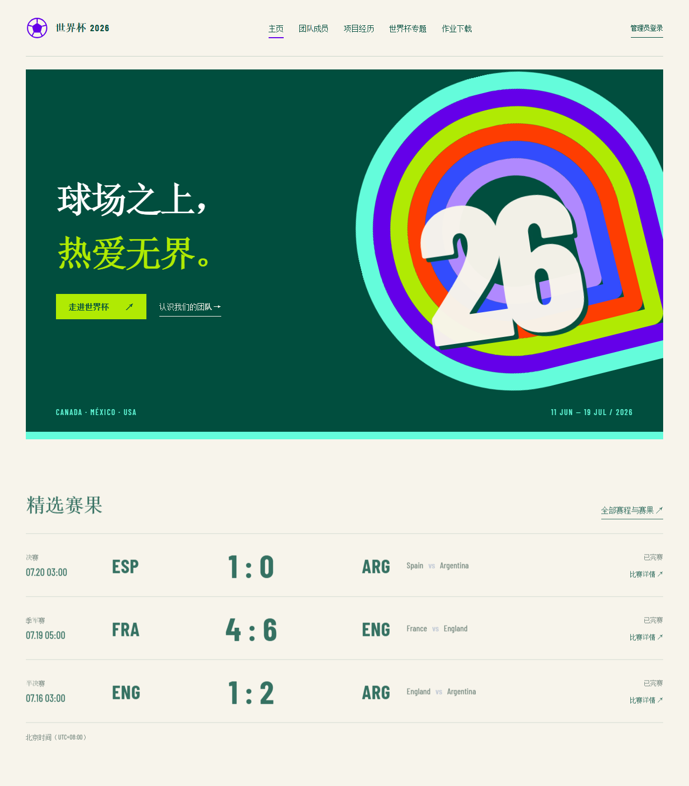

## 3 赛程与赛果

### 3.1 进入

点顶部"世界杯专题"，或直接访问 `http://127.0.0.1:8080/world-cup/matches`。默认停在"赛程与赛果"标签。

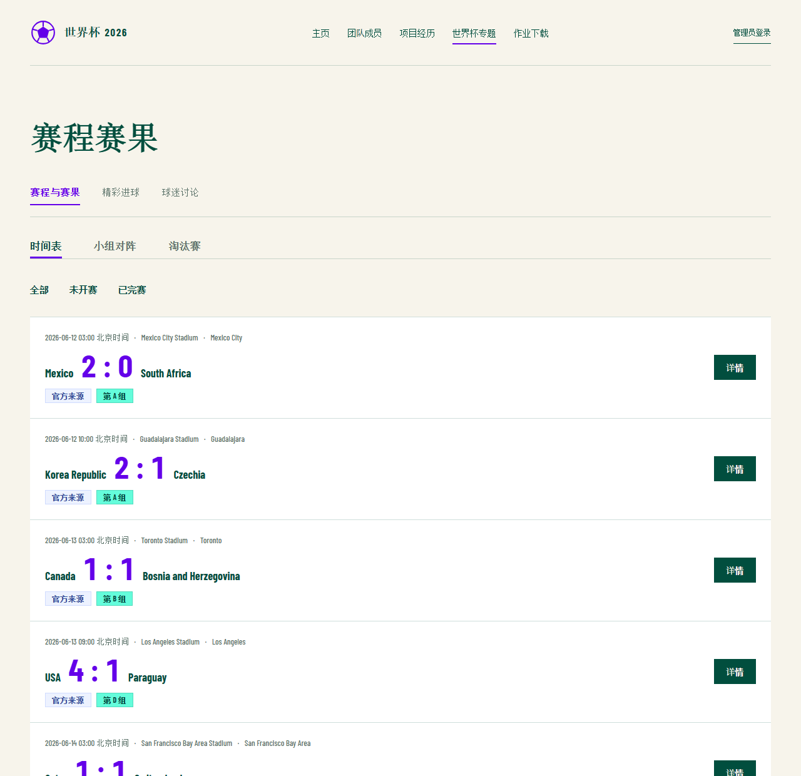

### 3.2 按状态筛选

标题下方一行三个筛选按钮：**全部**、**未开赛**、**已完赛**。点任意一个，列表立即刷新，地址栏会多出 `?status=scheduled` 或 `?status=finished`，这两个地址可以直接收藏或分享给同机的人。

- **全部**：按开球时间从早到晚，官方与演示记录都在，已完赛的显示比分。
- **未开赛**：只列还没开始的场次，比分位置显示"未开赛"。当前样本里全部场次都已完赛，所以这一页会显示空态"暂无符合条件的比赛"和一个"查看全部"按钮。
- **已完赛**：只列有比分的场次。

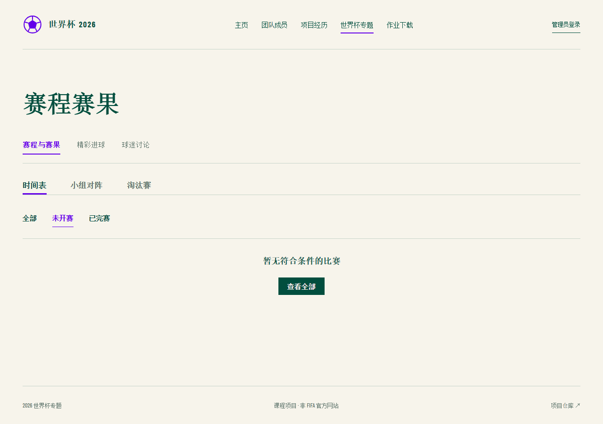

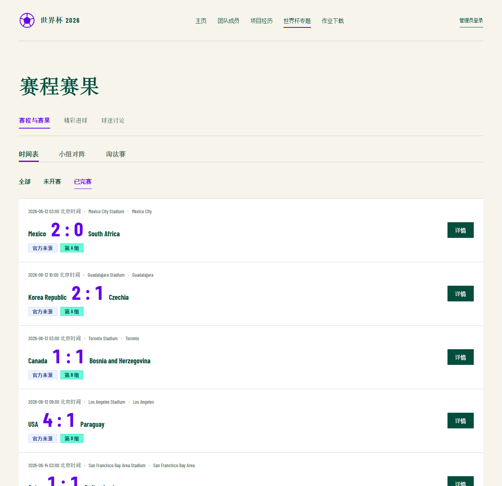

### 3.3 读一张比赛卡片

每张卡片固定六项信息，从上到下、从左到右依次是：开球时间（北京时间）、场馆与城市、主队名、比分、客队名、角标（官方来源或演示数据）与所属小组。右下角"详情"进详情页。

比分位置是理解这本手册的关键：已完赛显示如"2 : 0"；未开赛显示"未开赛"；**0:0 是有效比分**，与"没比分"完全不同。

### 3.4 翻页

列表每页 20 场，底部有"上一页""页码""下一页"。翻页时当前筛选不会丢失。

## 4 比赛详情

### 4.1 官方比赛

从列表点任意"详情"，或访问 `http://127.0.0.1:8080/world-cup/matches/1`。

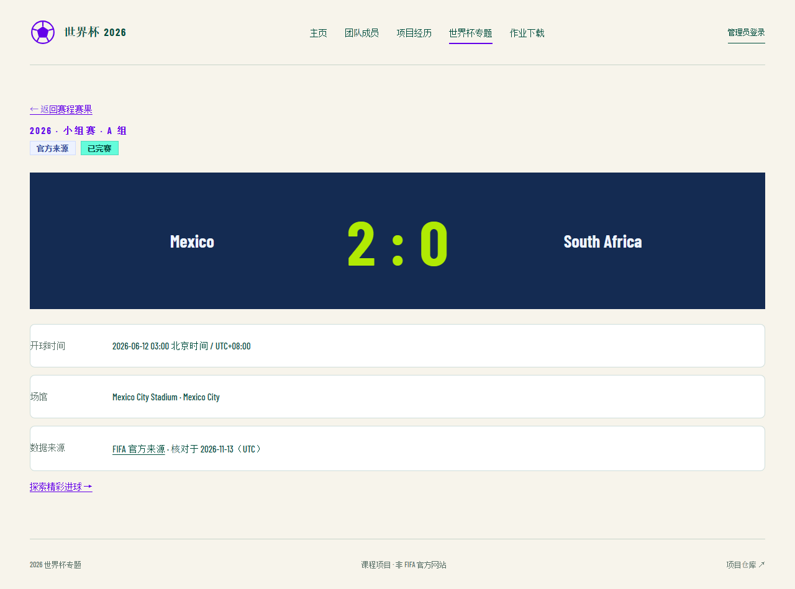

页面自上而下是：返回链接、届次与阶段（如"2026 · 小组赛 · A 组"）、来源角标与比赛状态、两队与比分、开球时间（同时给北京时间与 UTC+08:00）、场馆、数据来源。

"数据来源"一栏对官方记录给出可点击的"FIFA 官方来源"和核对日期，括号里注明时间的时区（UTC）。

### 4.2 演示比赛

演示记录的结构与官方相同，区别有三处：角标是"演示数据"；"数据来源"一栏写"课堂演示，非官方比赛及赛果"，没有外链；这类记录可以在后台继续修改或删除。

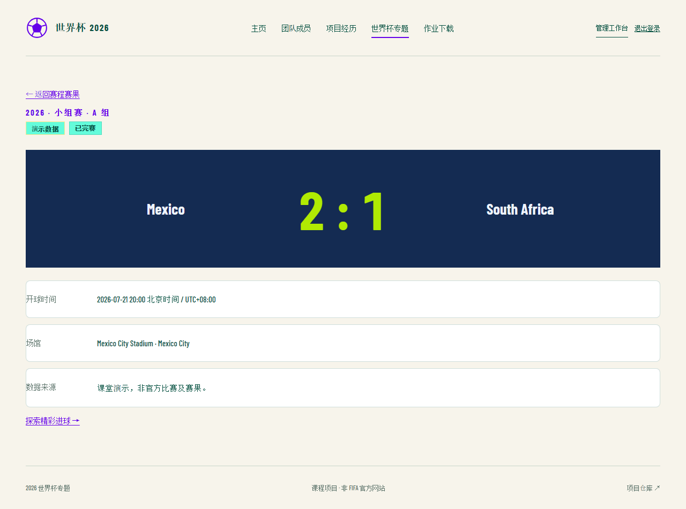

## 5 小组对阵与淘汰赛

赛程页第二行标签。"小组对阵"是一张按 A 到 L 排列的积分矩阵，每行六列：球队、胜、平、负、进球、失球，顶部有"官方/演示"切换。"淘汰赛"是从 32 强到决赛的对阵树，加时与点球会单独标注（如"点球 3–4""加时"）。

这两个页面只读，不提供编辑入口。

## 6 精彩进球

点"精彩进球"标签进入影像页。每张卡片是一个官方视频入口，卡片上有队名缩写、比赛双方与阶段，右下"前往官方观看"跳转 FIFA 官方视频页；底部"更多世界杯影像"是汇总入口。视频不在本站托管，本站只做索引。

## 7 留言（球迷讨论）

点"球迷讨论"标签进入留言页，或访问 `http://127.0.0.1:8080/guestbook`。

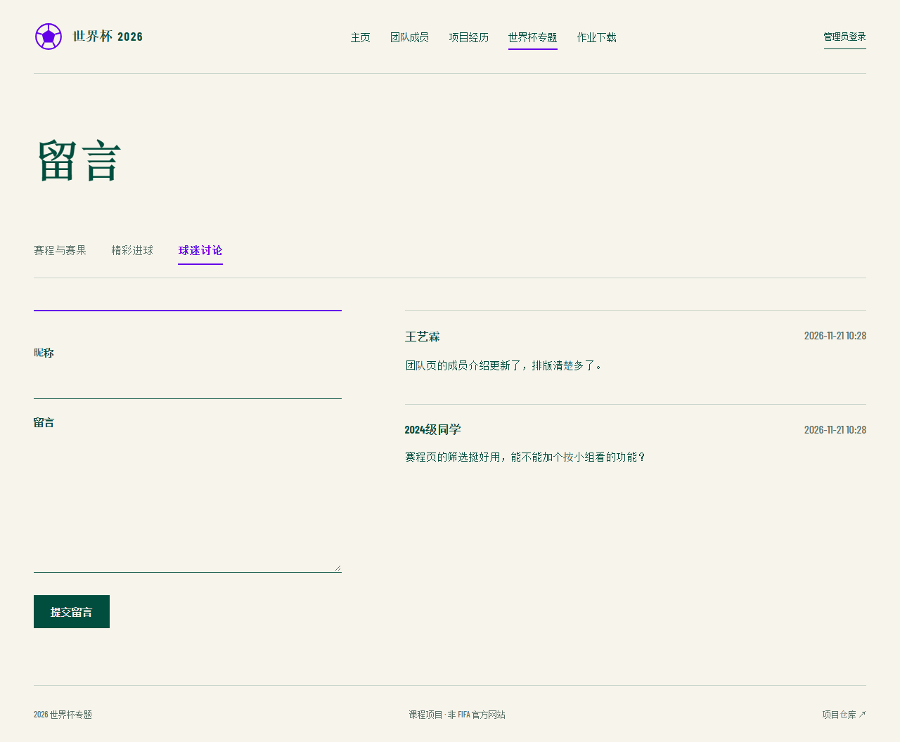

左侧是表单，两项：**昵称**（最多 80 字）和 **留言**（最多 2000 字）。填完点"提交留言"。

提交后页面顶部出现一行回执"留言已提交，待审核。"，同时这条留言不会立刻出现在右侧列表里——**新留言一律待审核**，只有管理员通过后才会公开。右侧列表按时间倒序显示已通过的留言，每条给出昵称与时间。

## 8 团队成员与项目经历

点顶部"团队成员"进入团队页。

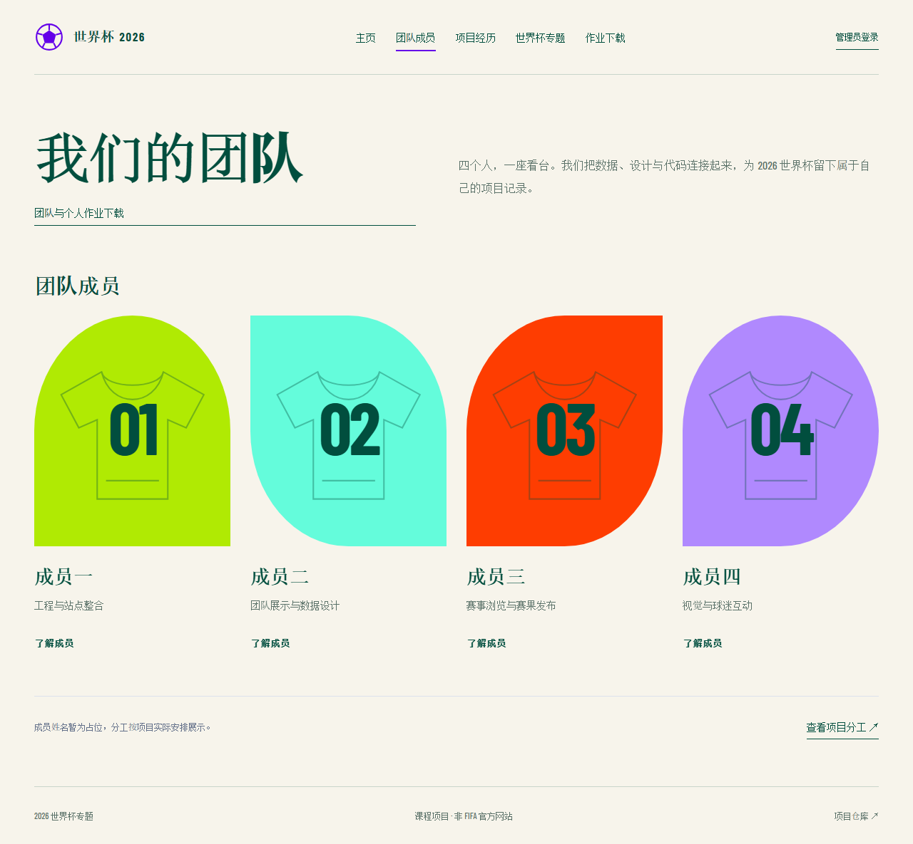

页面列出四位成员的编号、分工与"了解成员"按钮。点任意成员进入成员详情页，可以看到该成员的一句话介绍、"我的项目分工"三条清单与"已实现成果"链接。

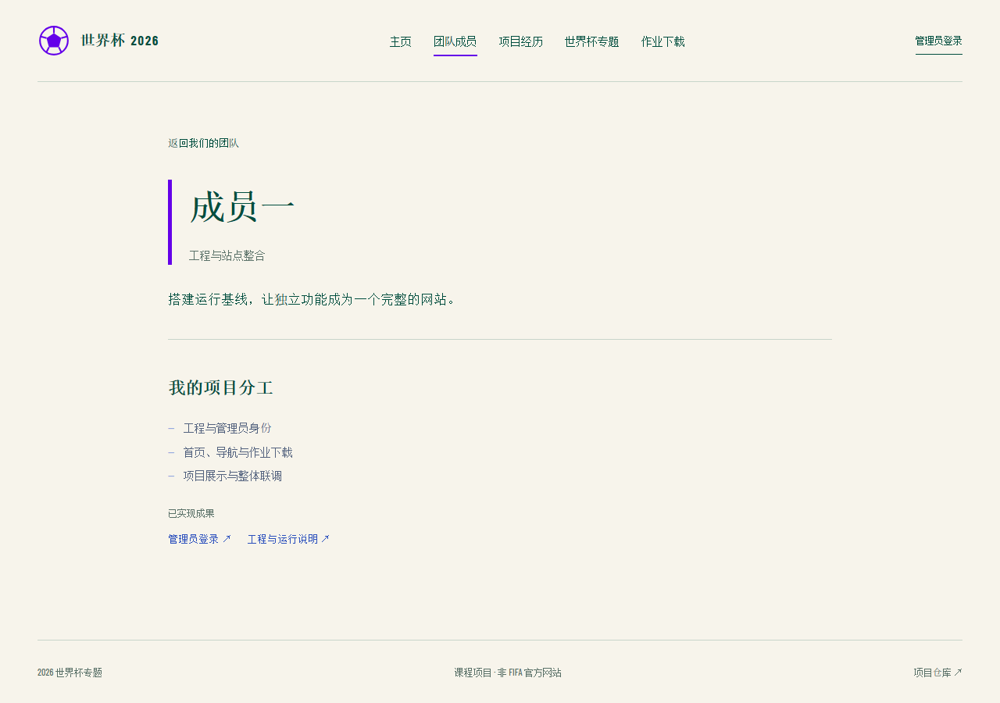

顶部"项目经历"是团队项目页，用于放课程项目的过程记录；团队页底部的"查看项目分工"也指向这里。

## 9 作业下载

点顶部"作业下载"进入 `http://127.0.0.1:8080/downloads`。

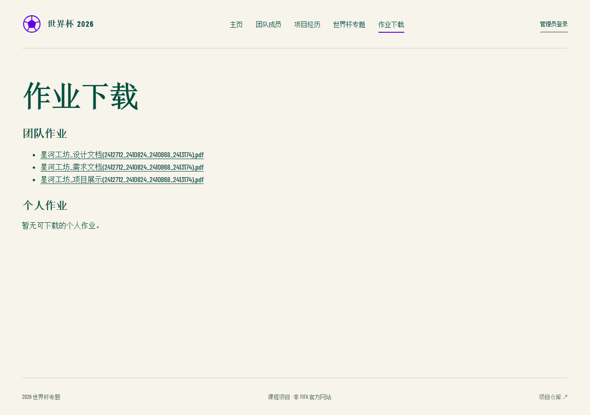

页面分两区：**团队作业** 与 **个人作业**。团队作业区列出 `/data/team/` 下的交付文件，文件名形如 `星河工坊_需求文档(2412712_2410824_2410868_2413174).pdf`，点文件名直接下载。个人作业区在个人作业归档完成前显示"暂无可下载的个人作业。"

点任意团队作业文件名，浏览器就开始下载同名 PDF。

## 10 管理员登录与工作台

### 10.1 登录

点右上角"管理员登录"，或访问 `http://127.0.0.1:8080/admin/login`。

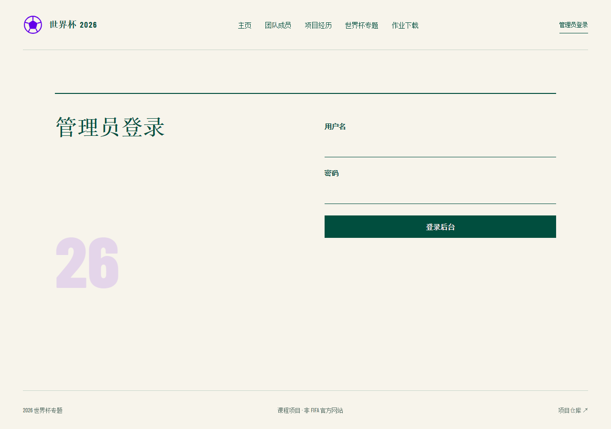

表单两项：用户名与密码。账号由项目负责人创建并保管，**本手册不写密码**；登录失败时页面会提示「用户名或密码错误。」。

### 10.2 工作台

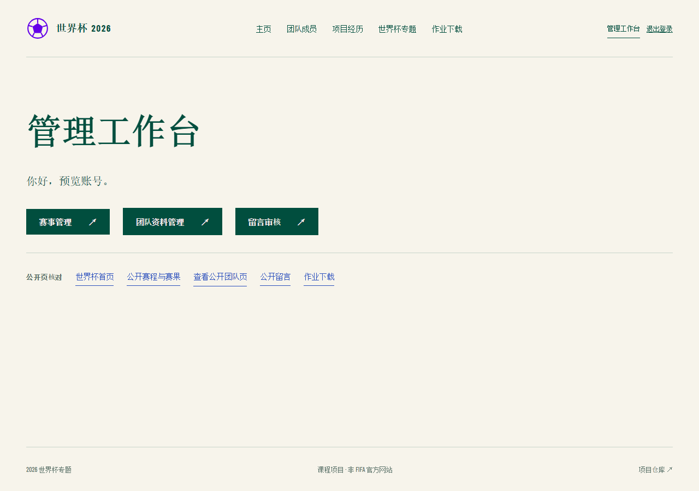

工作台是后台的首页，四个部分：一句问候；三个主入口"赛事管理""团队资料管理""留言审核"；"公开页核对"五个链接，用来一键跳到游客视角检查刚才的改动；右上"退出登录"。

## 11 赛事管理

### 11.1 列表

从工作台点"赛事管理"，或访问 `http://127.0.0.1:8080/admin/matches`。

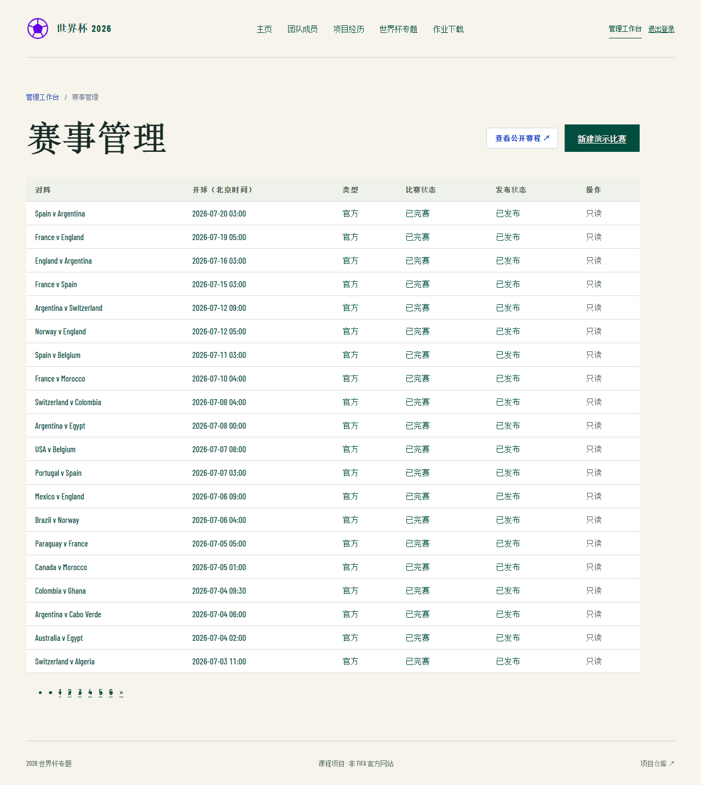

表格六列：对阵、开球（北京时间）、类型、比赛状态、发布状态、操作。官方记录的类型是"官方"，操作列显示"只读"——**官方记录不能在这里改**。演示记录可以点进去编辑。

右上两个按钮："查看公开赛程"跳到游客看到的列表，"新建演示比赛"开始一条新记录。

### 11.2 新建演示比赛

点"新建演示比赛"。

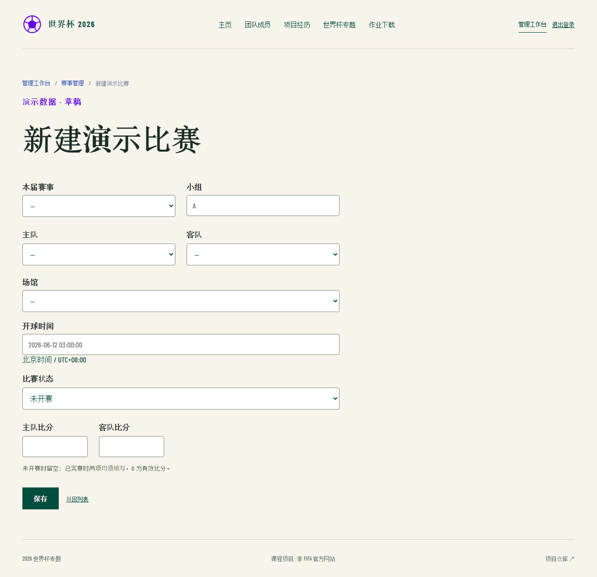

表单字段：

| 字段 | 填什么 |
| --- | --- |
| 本届赛事 | 下拉，当前只有 2026 一届 |
| 小组 | 小组名，如 A、B，可留空 |
| 主队、客队 | 下拉选国家队，两队不能相同 |
| 场馆 | 下拉选球场 |
| 开球时间 | 按"YYYY-MM-DD HH:mm:ss"填，按北京时间理解 |
| 比赛状态 | 未开赛或已完赛 |
| 主队比分、客队比分 | 未开赛留空；已完赛两项都必填，0 是有效比分 |

填完点"保存"。保存成功后回到该记录的编辑页，顶部提示「演示比赛已保存为草稿。」，页面标注"演示数据 · 草稿"。

### 11.3 发布

在编辑页底部点"发布"。发布是独立动作，与"保存"分开。

发布成功后页面提示「已发布到前台。」，标注变成"演示数据 · 已发布"，列表的"发布状态"列变成"已发布"。
### 11.4 录比分

把"比赛状态"改成"已完赛"，填两个比分（例：2 和 1），点"保存"，页面提示「修改已保存。」。

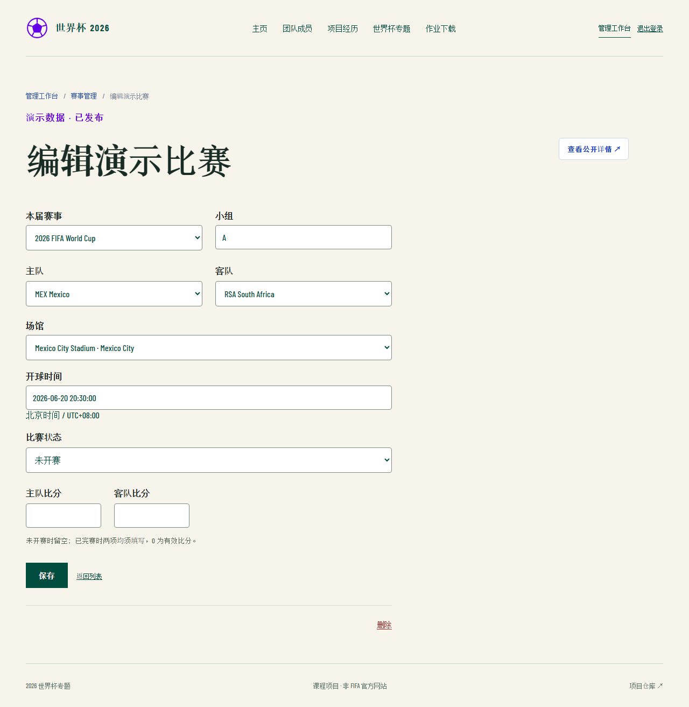

表单底部有一行提示："未开赛时留空；已完赛时两项均须填写，0 为有效比分。" 少填一个比分、或在未开赛状态填比分，保存都会失败并保留你填过的内容。

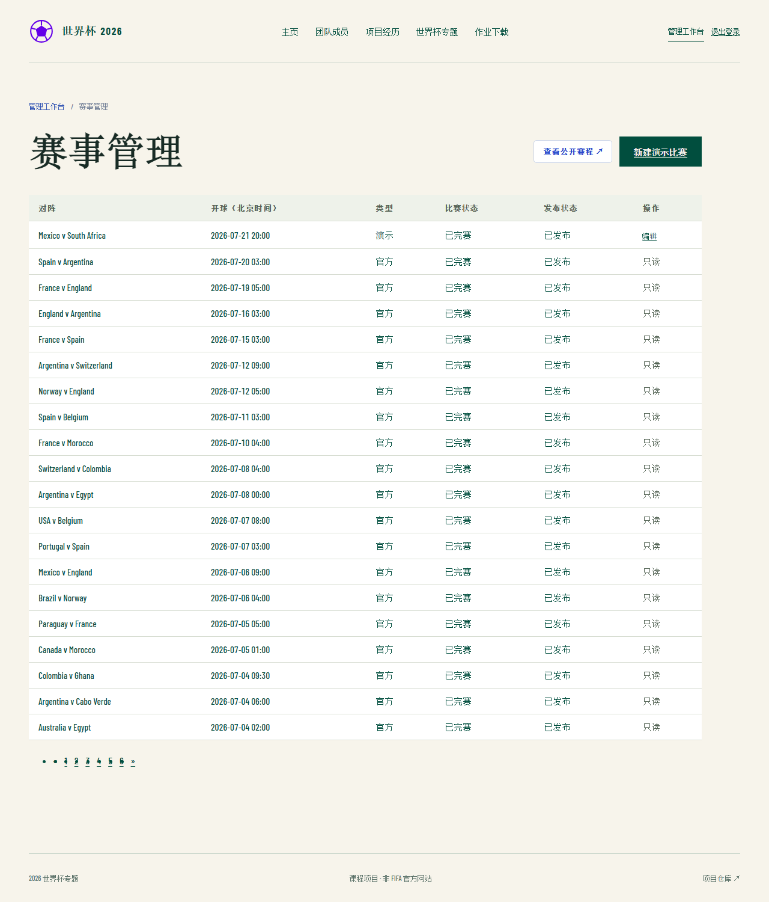

### 11.5 删除

编辑页底部的"删除"用于清理演示记录。点下去会弹出确认框"确定删除这条演示比赛？"，确认后回到列表，提示"演示比赛已删除。"

官方记录没有删除入口；即使手工构造请求，服务端也会拒绝。

## 12 团队资料与成员编辑

从工作台点"团队资料管理"。

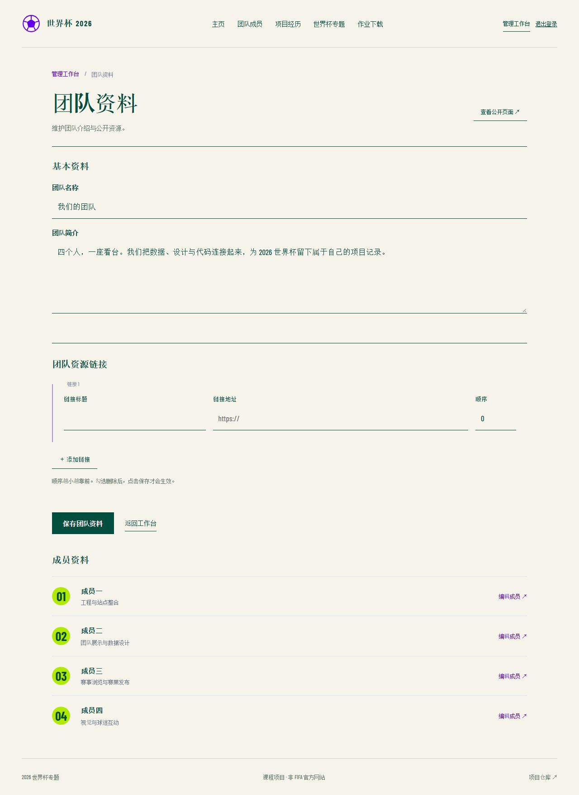

上半部分是团队资料：**团队名称**、**团队简介**、以及可增删的**团队资源链接**（链接标题、链接地址、顺序）。顺序数字越小越靠前；勾选删除后要再点"保存团队资料"才生效。

下半部分是成员资料，四位成员各一行，点"编辑成员"可以改该成员的介绍、分工与成果链接。

## 13 留言审核

从工作台点"留言审核"。

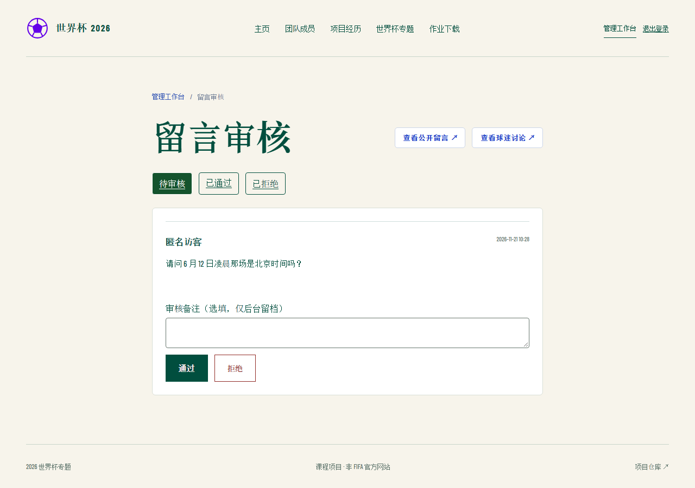

顶部三个标签：**待审核**、**已通过**、**已拒绝**。每条待审留言显示昵称、提交时间、正文，下面一行"审核备注（选填，仅后台留档）"和两个按钮"通过""拒绝"。

点"通过"后这条留言进入"已通过"标签，同时出现在公开留言列表；点"拒绝"则只留在后台，公开页永远看不到。

## 附录 A 常见问题

1. **页面打不开。** 先确认地址是 `http://127.0.0.1:8080/`，且站点已在本机启动。换一个页面试试，若首页能开、赛程页打不开，通常是数据库没有导入样本。
2. **未开赛的比赛为什么没有比分？** 没踢的比赛没有比分，页面显示"未开赛"。这不是数据缺失，也不是 0:0。
3. **0:0 和空的区别。** 0:0 是踢完以后的真实比分，会出现在"已完赛"筛选里；空是还没踢。
4. **为什么某场比赛在公开页找不到？** 三种可能：它还是草稿没发布；它属于别的届次；地址里的编号不存在。
5. **后台入口在哪？** 右上角"管理员登录"；登录后变成"管理工作台"。
6. **演示数据会不会混进官方统计？** 不会。演示记录在公开页始终带"演示数据"角标，详情页写明不是官方赛果。
7. **留言提交后为什么不显示？** 新留言一律待审核，管理员通过后才公开。
8. **同一条比赛能重复导入吗？** 样本导入按 `sample_key` 幂等，重复执行不会产生重复记录，也不会覆盖已改过的演示记录。
9. **改了团队简介但公开页没变？** 确认点了"保存团队资料"，并注意浏览器缓存；刷新后仍不变，检查是否勾选了删除。

## 附录 B 页面速查

| 页面 | 地址 | 谁能看 |
| --- | --- | --- |
| 主页 | `/` | 所有人 |
| 团队成员 | `/team` | 所有人 |
| 成员详情 | `/team/members/{id}` | 所有人 |
| 项目经历 | `/project` | 所有人 |
| 赛程与赛果 | `/world-cup/matches` | 所有人，仅显示已发布 |
| 比赛详情 | `/world-cup/matches/{id}` | 所有人，草稿与不存在的编号返回 404 |
| 小组对阵 | `/world-cup/groups` | 所有人 |
| 淘汰赛 | `/world-cup/bracket` | 所有人 |
| 精彩进球 | `/world-cup/highlights` | 所有人 |
| 球迷讨论 | `/world-cup/fans` | 所有人 |
| 留言 | `/guestbook` | 所有人，仅显示已通过 |
| 作业下载 | `/downloads` | 所有人 |
| 管理员登录 | `/admin/login` | 所有人 |
| 管理工作台 | `/admin` | 已登录 |
| 赛事管理 | `/admin/matches` | 已登录 |
| 团队资料管理 | `/admin/team` | 已登录 |
| 留言审核 | `/admin/messages` | 已登录 |
